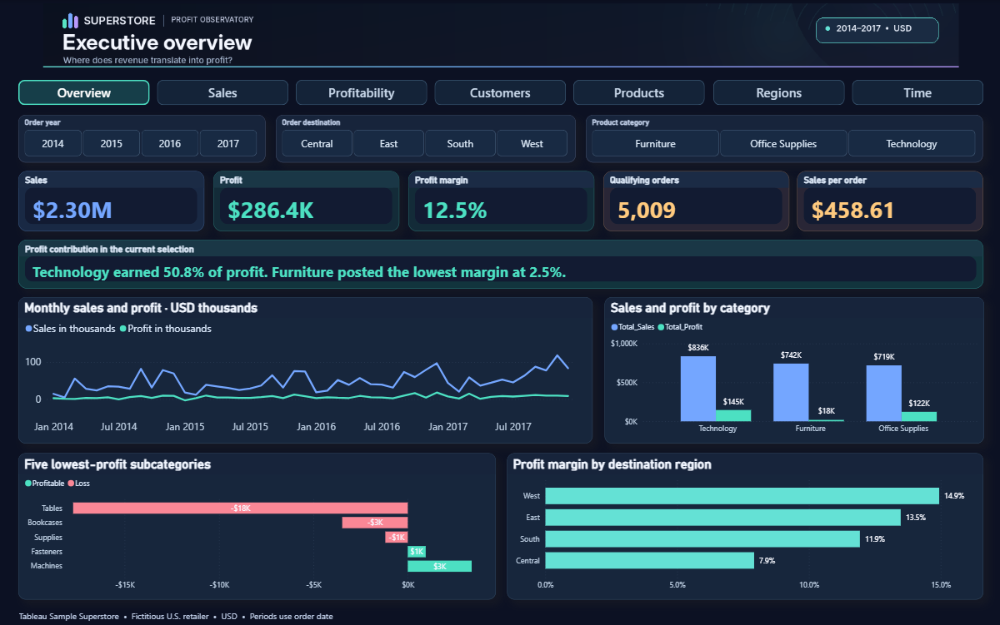
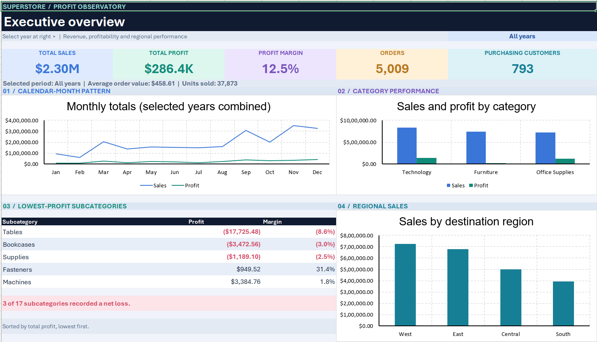
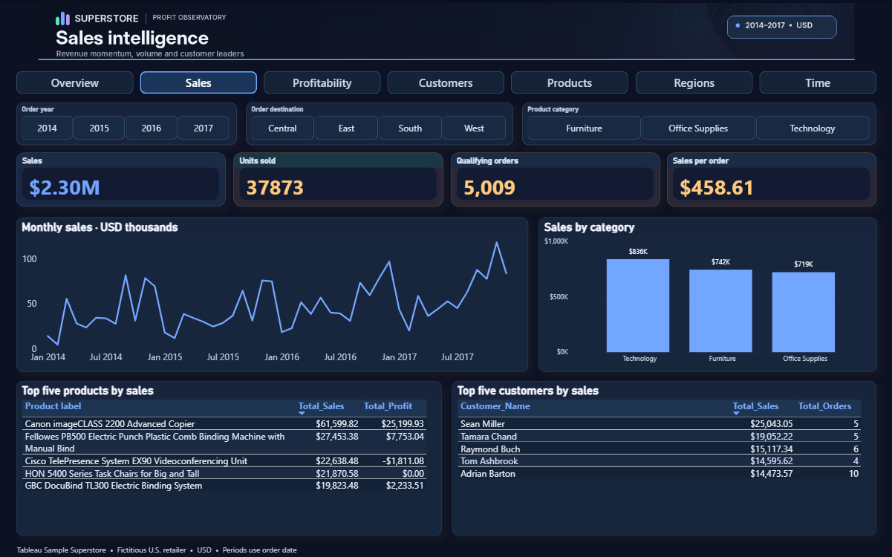
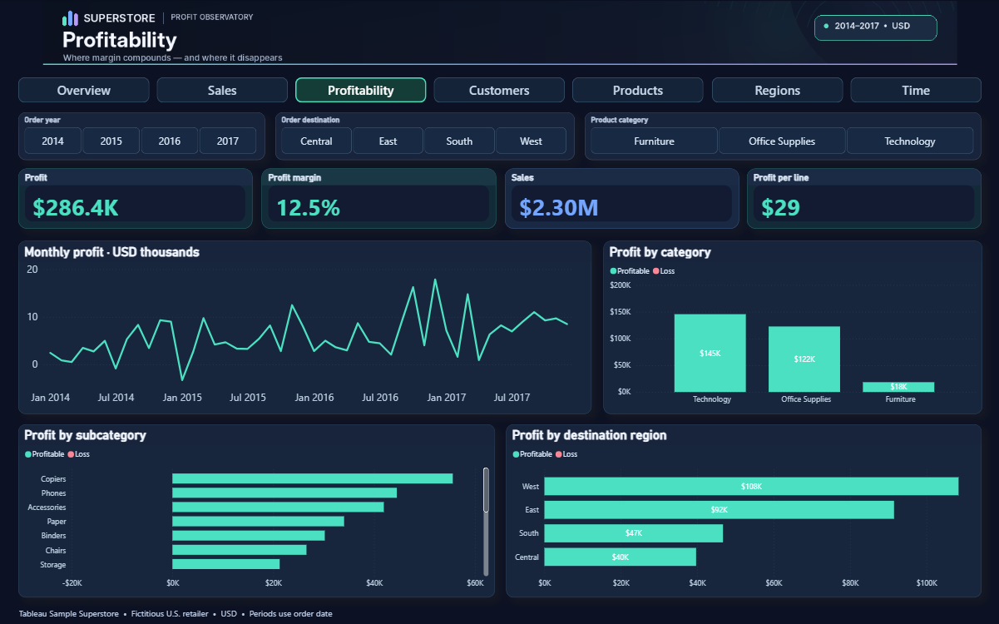
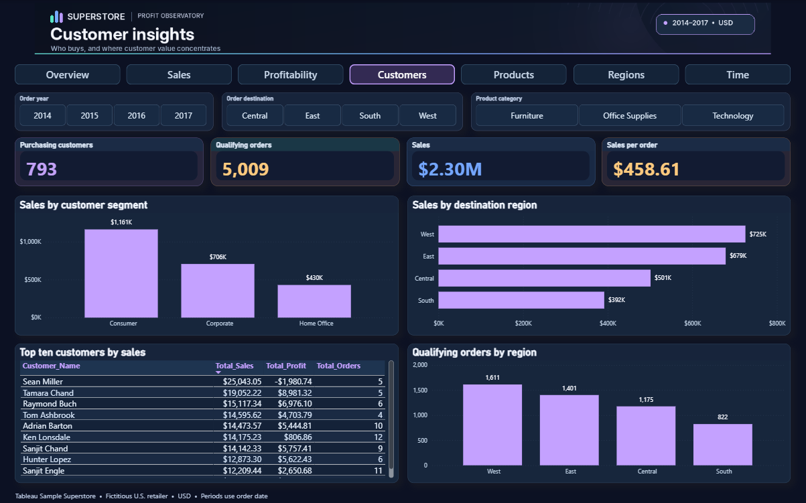
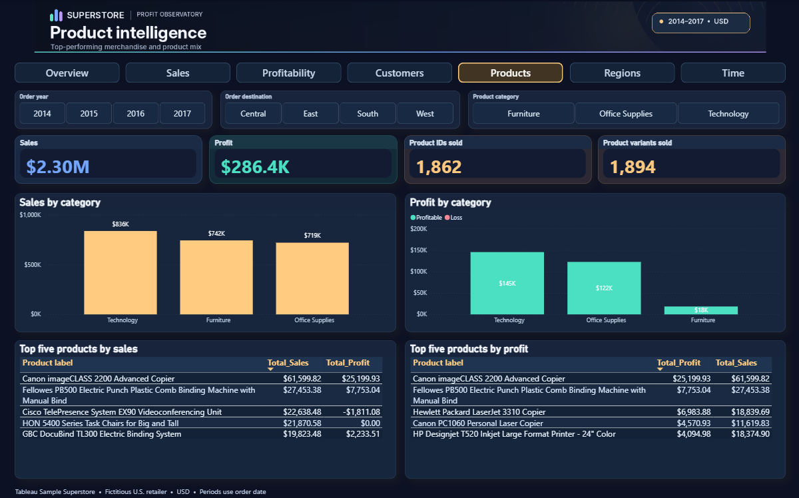
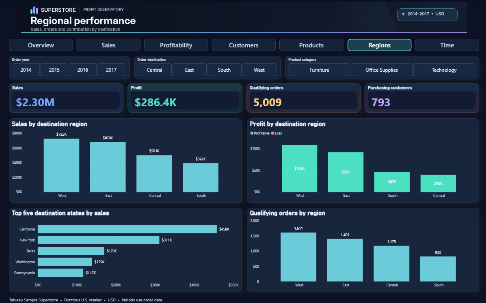
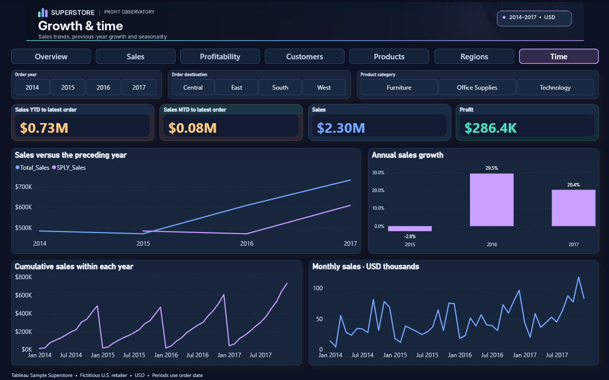
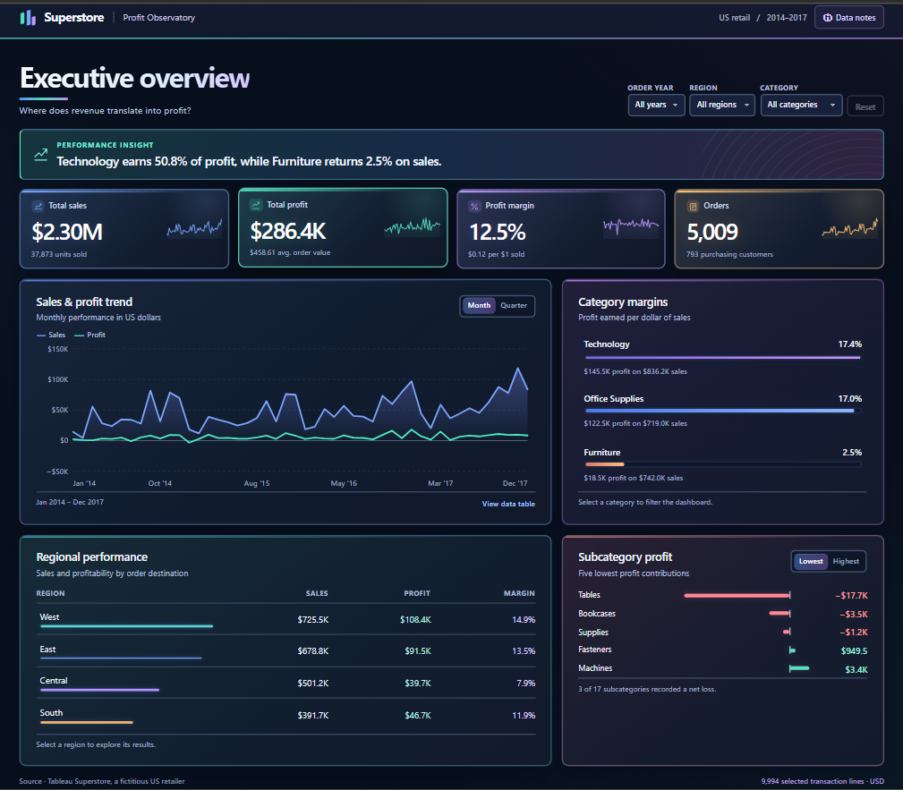

# 📊 Superstore Profit Observatory - Retail Sales Analytics

**Excel • PostgreSQL • Power BI • DAX • Power Query • HTML • CSS • JavaScript**

An end-to-end retail analytics portfolio project that investigates **where sales translate into profit - and where they do not**.

Originally developed in July 2025 using Excel, SQL and Power BI, the project was substantially revised in November 2026 through a data-quality audit, corrected relational modeling, a redesigned seven-page Power BI report, and a responsive interactive web dashboard.

**Dataset:** Tableau Sample Superstore - a publicly available sample representing a fictitious U.S. retailer (2014–2017). Monetary amounts are in USD. Time-based analyses use order dates.

[Dataset source information](https://public.tableau.com/app/resources/sample-data) · [Standalone web dashboard](./Superstore-Overview.html) · [Power BI setup](./README-PowerBI.md) · [Data validation](./README-data.md)

[Open the live Aurora dashboard](https://cool-taiyaki-ddbfe5.netlify.app/)



## 🎯 Business questions

- How have sales and profitability changed over time?
- Which product categories and subcategories generate profit or losses?
- Which regions have the strongest sales and profit margins?
- Which customers and products contribute most to revenue and profit?
- How do current-year sales compare with previous-year sales?

## 📌 Validated results

| Metric | Value |
|---|---:|
| Transaction lines | 9,994 |
| Distinct orders | 5,009 |
| Purchasing customers | 793 |
| Source product IDs | 1,862 |
| Product ID/name variants | 1,894 |
| Units sold | 37,873 |
| Total sales | $2,297,200.86 |
| Total profit | $286,397.02 |
| Profit margin | 12.47% |
| Average order value | $458.61 |

### Key insights

- Technology generates $836.2K in sales and $145.5K in profit, contributing 50.8% of total profit.
- Furniture generates approximately $742.0K in sales but achieves only a 2.5% profit margin.
- Tables is the lowest-profit subcategory, recording a loss of approximately $17.7K.
- The West region leads in sales ($725.5K) and profit ($108.4K), with a 14.9% profit margin.

These results refer to the complete, unfiltered historical sample, not current retail market conditions.

## 🧹 Data-quality audit and corrections

| Issue | Resolution |
|---|---|
| Ambiguous order and shipping dates | Reconciled date interpretation and verified shipping intervals of 0–7 days. |
| Eight transaction lines lost during normalization | Restored all 9,994 source lines and assigned a unique `line_item_id`. |
| Incorrect customer-level geographic attribution | Moved destination geography to the order level. |
| Product IDs associated with multiple recorded names | Introduced `product_key` to identify 1,894 ID/name variants without losing the 1,862 source product IDs. |
| Incorrect filter-sensitive counts | Calculated distinct orders and customers from the filtered order-line table. |

The corrected PostgreSQL schema, `superstore_v2`, preserves the original database tables. A repeatable SQL loader validates the records before committing, and separate SQL and DAX queries support reconciliation.

See [data documentation](./README-data.md) and [date-validation notes](./date-validation.md) for details.

## 🛠️ Project workflow

### Excel — original reporting phase

- Power Query connection, PivotTables, PivotCharts, KPI formulas and a Segment slicer.
- Macro-enabled workbook with VBA-controlled PivotTable/slicer connectivity.
- Analysis of regional sales, category profit, products and time-based sales.

The Excel workbook and original SQL analyses document the earlier implementation. The corrected November 2026 dataset and Power BI model are the authoritative versions for the revised figures.



### PostgreSQL - relational analysis and data validation

- Flat-table and relational SQL analysis using JOINs, CTEs, aggregations, subqueries, date functions and `LAG()` for year-over-year comparison.
- Four normalized tables: `customers`, `products`, `orders` and `order_details`.
- Primary and foreign keys, order-line grain, destination-level geography and product-variant identity.
- Reconciliation of row counts, monetary totals, shipping intervals and filtered populations.

### Power BI - seven-page executive report

- Interactive year, destination region and product category slicers.
- Consistent page navigation, coordinated dark-theme styling and signed profit/loss colors.
- DAX measures for sales, profit, margin, order and customer counts, average order value, YTD, MTD, SPLY and YoY growth.
- Filter-responsive executive takeaway and a dedicated date table.
- Editable Power BI Project (`.pbip`) with report and semantic-model definitions.

## 📷 Power BI report pages

### 1. Executive Overview

Sales, profit, margin, qualifying orders, average order value, monthly trends, category performance, loss-making subcategories and regional margins.


### 2. Sales Intelligence

Monthly sales trends, category sales, units sold, and top products and customers by sales.



### 3. Profitability

Monthly profit, category and subcategory profitability, regional profit, and profit per transaction line.



### 4. Customer Insights

Purchasing customers, customer-segment performance, destination-region sales, order counts and top customers.



### 5. Product Intelligence

Product category performance, source product and variant counts, and top products ranked by sales and profit.



### 6. Regional Performance

Sales and profit by order destination, qualifying orders by region and top destination states by sales.



### 7. Growth & Time

Year-to-date and month-to-date sales, prior-year comparisons, annual growth, cumulative sales and monthly trends.



## 🌐 Aurora - interactive web dashboard

A responsive, standalone executive dashboard created as an extension of the Power BI project for the Handshake *Turn Data into an Interactive Dashboard* learning mission.

- Year, region and category filtering with chart-driven selections and reset.
- KPI cards with sparklines and a filter-responsive insight.
- Monthly/quarterly sales and profit trends, category margins, regional performance and subcategory profit rankings.
- Chart tooltips, data-table view and data notes.
- Embedded corrected data; no PostgreSQL server or Power BI installation is required to use the HTML version.



To explore offline, download [Superstore-Overview.html](./Superstore-Overview.html) from GitHub and open the downloaded file in a browser. GitHub's file preview displays source code rather than running the interactive page.

## ✅ Validation and reproducibility

The corrected PostgreSQL database was loaded and checked locally. The Power BI project was opened and visually inspected in Power BI Desktop. The standalone web dashboard was tested separately for filtering, chart interactions and responsive layout.

| Selection | Lines | Orders | Customers | Sales | Profit |
|---|---:|---:|---:|---:|---:|
| All records | 9,994 | 5,009 | 793 | $2,297,200.86 | $286,397.02 |
| Technology | 1,847 | 1,544 | 687 | $836,154.03 | $145,454.95 |
| West | 3,203 | 1,611 | 686 | $725,457.82 | $108,418.45 |

Orders and purchasing customers are distinct counts within the selected transaction population and are not additive across overlapping categories.

## 📁 Repository structure

```text
Excel/                    Original Excel workbook and screenshot
SQL/                      Original flat and relational SQL analysis
data/                    Corrected CSVs and date reconciliation
postgres/                PostgreSQL loader and verification scripts
powerbi/                 Editable PBIP report and semantic model
screenshots/             Final report and web dashboard screenshots
Superstore-Overview.html Standalone Aurora web dashboard
README-data.md           Data documentation
README-PowerBI.md        Power BI setup and validation guide
date-validation.md       Date correction notes
```

## 🚀 Run the project locally

### Web dashboard

Download `Superstore-Overview.html` and open it in a browser. No additional setup is required.

### PostgreSQL and Power BI

1. Clone or download this repository and extract it. Install PostgreSQL and Power BI Desktop for Windows if needed.
2. Create an empty database named `superstore_data` if it does not already exist. Use an authorized PostgreSQL account.
3. From the repository root, run the following commands (use the full path to `psql.exe` if it is not on your PATH):

```powershell
psql -X -h localhost -p 5432 -U postgres -d superstore_data -W -f ".\postgres\load_superstore_v2.sql"
psql -X -h localhost -p 5432 -U postgres -d superstore_data -W -f ".\postgres\verify.sql"
```

4. Open `powerbi/Superstore_Executive.pbip` in Power BI Desktop. Keep its `.Report` and `.SemanticModel` folders together with the `.pbip` file.
5. Configure database credentials if prompted, refresh the report, and run [Validation.dax](./powerbi/Validation.dax) in DAX query view.

See [README-PowerBI.md](./README-PowerBI.md) for alternate connection settings and detailed instructions. No database credentials are included in the project.

## 💡 Skills demonstrated

Data cleaning and reconciliation • Relational modeling • SQL analysis • Excel reporting • Power Query • DAX • Time intelligence • KPI design • Dashboard usability • Interactive web visualization • Testing and validation

## 🤝 Development approach

This is an independent portfolio and learning project, not production analytics for an actual retailer. The original Excel, SQL and Power BI work was extended using AI-assisted auditing, code generation, debugging and visual refinement. I reviewed the results, loaded and verified the corrected PostgreSQL schema locally, and inspected the redesigned report in Power BI Desktop.
